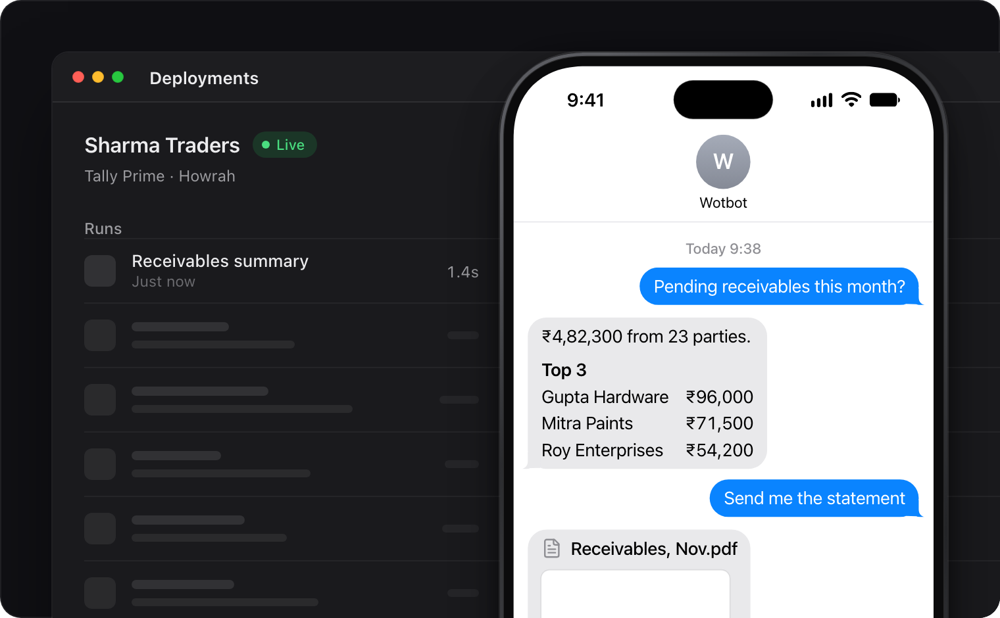

<picture>
  <source media="(max-width: 600px)" srcset="assets/hero-compact.png">
  
</picture>

# Bhagaban Paul

Forward Deployed Engineer at [Vyohm AI](https://www.vyohm.com). I take AI agents the last mile into a business: into its ERP, onto the WhatsApp number its owner already uses, and through the weeks until the answers it gives are the ones the owner trusts.

## What I'm working on

Vyohm builds AI agents for Indian MSMEs, businesses that run on WhatsApp and mostly don't want another app.

- **[wotbot.ai](https://www.wotbot.ai)** answers questions about stock, receivables and sales straight from the customer's ERP, on WhatsApp.
- **[shotbot.ai](https://shotbot.ai)** turns a product photo into a studio shot, also over WhatsApp.

My part is the deployment: connecting each customer's data, shaping the agent around how that business actually talks, and fixing what breaks in the field.

Earlier projects: a cancer-detection model on medical imaging, a deepfake-detection platform, and AI customer-support systems.

## Stack

| | |
|---|---|
| Frontend | React, Next.js, TypeScript, Tailwind |
| Mobile | React Native, Expo |
| Backend | Node.js, Express, Bun |
| Data | PostgreSQL, MongoDB, Supabase, Firebase · Drizzle, Prisma |
| AI / ML | Python, TensorFlow, computer vision |
| Cloud | AWS, Docker |

## Elsewhere

[LinkedIn](https://www.linkedin.com/in/bhagaban-paul-380350278/) · [bhagaban.dev](https://bhagaban.dev) · [Email](mailto:bhagwanpalofficial@gmail.com)
